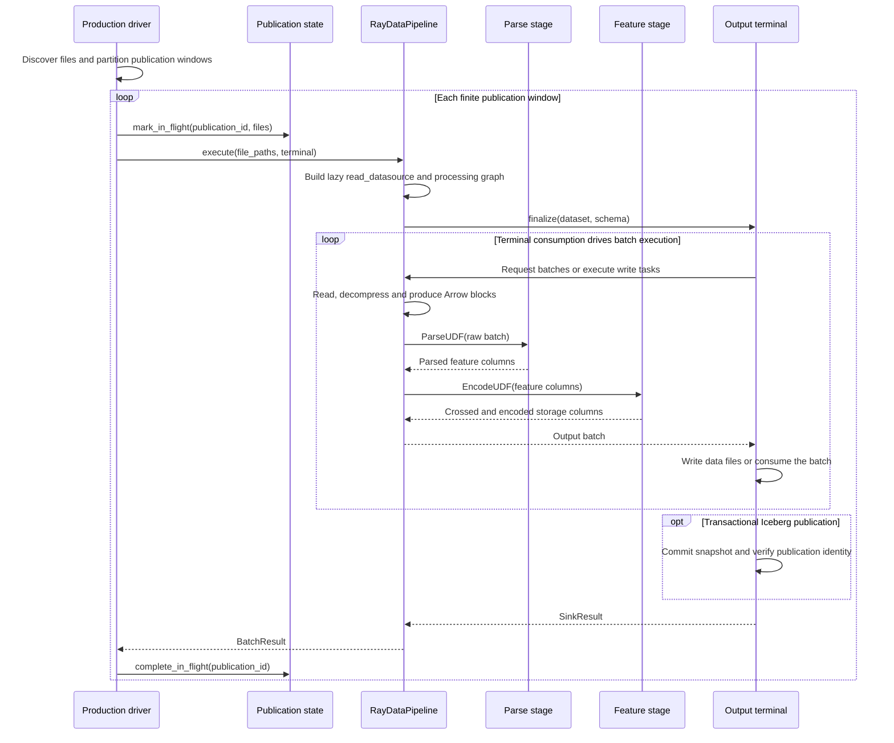

# Data Pipeline Architecture

This document defines the architectural responsibilities and module boundaries of `src/flare/data`.

## Module Boundaries

The public data layer strictly separates production from consumption. Both sides share generic format adapters and structural value objects, but maintain completely decoupled lifecycles, authentication mechanisms, and recovery rules. Consumption serves model training, evaluation, and downstream tasks; production does not depend on model state or consumer progress.

```text
src/flare/data/
├── contracts/       Typed stage inputs, outputs, and structural contracts
├── schema/          Generic structural layouts and batch transforms
├── sources/         Intervals (RecordRange), physical locators, and revision values
├── connectors/      External storage and format adapters (Iceberg, Parquet, etc.)
├── execution/       Production planning and execution assembly
└── pipeline/
    ├── production/  Row parsing, processing, and publishing
    └── consumption/ Range reading, batch assembly, and device delivery
```

| Domain Fact / Responsibility | Owning Component |
| --- | --- |
| External snapshots, files, and native metadata | `connectors/` format adapters |
| File intervals and physical locations | Value objects in `sources/` |
| Config parsing and source object construction | `pipeline/consumption/bootstrap/factory.py` |
| Range to execution work item translation | `src/flare/runtime/fluxway/source.py` |
| Task leases and global consumption progress | Control plane planner, solver, and task ledger |
| File reads, decoding, buffering, and batch transforms | Format readers, `schema`, and `dataloader` |
| Joint checkpoint of model and source progress | `checkpoint` contract component registry |

File row numbers, scan positions, and execution steps belong to different coordinate spaces. Flare readers decode and materialize assigned ranges; they do not discover tables or invent global cursors. Model and source states are joined exclusively through the checkpoint contract.

## Processing and Publication Sequence

`DataPipeline.run()` assembles the production pipeline. Feature configuration is
compiled into a processing artifact and output schema, and a feature manifest is
written for consumers. The sequence below uses HDFS publication windows with
resume state. Local input executes one finite file manifest directly, without a
publication lease.



- **Stages:** `HdfsZstdDatasource` reads and decompresses input; `ParseUDF`
  parses rows; `EncodeUDF` executes the compiled feature crosses and encoders.
  `fuse_parse_encode` combines the latter two into one physical stage without
  changing the output contract.
- **Execution and backpressure:** Terminal consumption executes the lazy Ray
  Data graph. Concurrency, block sizes, generator buffers and downstream capacity
  bound in-flight data. Publication windows bound the files in one submission.
- **Publication and recovery:** The Iceberg terminal stores publication identity
  in snapshot properties. If a failure occurs after commit but before the resume
  record is updated, recovery reconciles that identity before marking completion
  or retrying. Nontransactional terminals do not provide the same commit
  reconciliation guarantee or establish exactly-once publication.
- **Independent progress:** Production resume state tracks file publication;
  training or evaluation checkpoints track consumption. Consumers discover data
  through committed storage state, independently of production resume records.

## Code Entrypoints and Further Reading

| Entrypoint | Responsibility |
| --- | --- |
| [`DataPipeline.run()`](../src/flare/data/pipeline/production/pipeline.py) | Configuration, reconciliation and runtime assembly |
| [`RayDataPipeline.execute()`](../src/flare/data/pipeline/production/publish/orchestrator.py) | Reading, parsing, feature processing and terminal execution |
| [`execute_publication()`](../src/flare/data/pipeline/production/publication/session.py) | Publication leases and completion state |
| [`IcebergSnapshotPublisher`](../src/flare/data/connectors/adapters/iceberg/sink.py) | Transactional publication and commit verification |

See [dataloader execution](dataloader.md) for consumption and
[streaming sources](streaming_source.md) for continuous append, idle and recovery
sequences.
