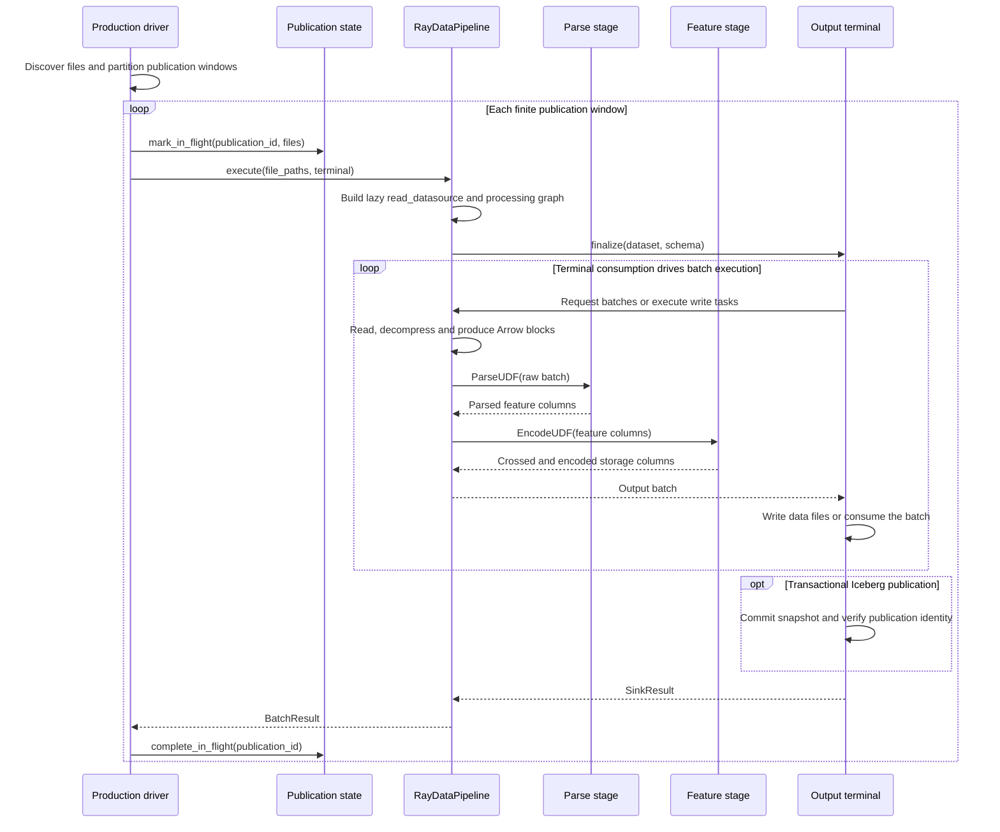

# Data Pipeline Architecture

[中文](data_pipeline_architecture_zh.md)

This document defines the architectural responsibilities and module boundaries of `src/flare/data`.

## Module Boundaries

The public data layer strictly separates production from consumption. Both sides share generic format adapters and structural value objects, but maintain completely decoupled lifecycles, authentication mechanisms, and recovery rules. Consumption serves model training, evaluation, and downstream tasks; production does not depend on model state or consumer progress.

```text
src/flare/data/
├── contracts/       Typed stage inputs, outputs, and structural contracts
├── schema/          Generic structural layouts and batch transforms
├── sources/         Intervals (RecordRange), physical locators, and revision values
├── connectors/      External storage and format adapters (Iceberg, Parquet, etc.)
├── execution/       Production planning and execution assembly
└── pipeline/
    ├── production/  Row parsing, processing, and publishing
    └── consumption/ Range reading, batch assembly, and device delivery
```

| Domain Fact / Responsibility | Owning Component |
| --- | --- |
| External snapshots, files, and native metadata | `connectors/` format adapters |
| File intervals and physical locations | Value objects in `sources/` |
| Config parsing and source object construction | `pipeline/consumption/bootstrap/factory.py` |
| Range to execution work item translation | `src/flare/runtime/fluxway/source.py` |
| Task leases and global consumption progress | Control plane planner, solver, and task ledger |
| File reads, decoding, buffering, and batch transforms | Format readers, `schema`, and `dataloader` |
| Joint checkpoint of model and source progress | `checkpoint` contract component registry |

File row numbers, scan positions, and execution steps belong to different coordinate spaces. Flare readers decode and materialize assigned ranges; they do not discover tables or invent global cursors. Model and source states are joined exclusively through the checkpoint contract.

## Storage and Progress

Consumers read committed tables and metadata through bounded or continuous scans.
Producers do not send consumers private task lists or progress files.
`create_scan_planner` plans scans, readers load assigned ranges, and checkpoints
align model state with source progress.

## Processing and Publication Sequence

`DataPipeline.run()` assembles the production pipeline. Feature configuration is
compiled into a processing artifact and output schema, and a feature manifest is
written for consumers. Local and partitioned inputs share deterministic file
manifests, publication windows and leases. Discovery filters committed files first:
missing input raises an error, while fully processed input returns without starting
Ray or appending data again. The sequence below shows each finite publication window.



- **Stages:** `HdfsZstdDatasource` reads and decompresses input; `ParseUDF`
  parses rows; `EncodeUDF` executes the compiled feature crosses and encoders.
  `fuse_parse_encode` combines the latter two into one physical stage without
  changing the output contract.
- **Execution and backpressure:** Terminal consumption executes the lazy Ray
  Data graph. Concurrency, block sizes, generator buffers and downstream capacity
  bound in-flight data. Publication windows bound the files in one submission.
- **Publication and recovery:** The Iceberg terminal stores publication identity
  in snapshot properties. If a failure occurs after commit but before the resume
  record is updated, recovery reconciles that identity before marking completion
  or retrying. Nontransactional terminals do not provide the same commit
  reconciliation guarantee or establish exactly-once publication.
- **Independent progress:** Production resume state tracks file publication;
  training or evaluation checkpoints track consumption. Consumers discover data
  through committed storage state, independently of production resume records.

## Source and Catalog Sessions

`PartitionedSourceProvider` supplies directory listing and file reads;
`IcebergCatalogProvider` supplies table access. Drivers and workers open and close
their own sessions instead of sharing live connections. Ordinary Iceberg settings
use `ConfiguredIcebergCatalogProvider`.

Without an injected source provider, discovery and reads use the standard
filesystem selected by PyArrow from the URI. Custom gateway discovery,
authentication protocols and deployment identities belong to external providers;
the public data layer does not select deployment modes from environment variables.
New transports implement and inject the existing source protocol.

Partition defaults are explicit `source_partition_defaults` values supplied by the
caller. The Iceberg format adapter accepts row-count hints and byte coalescing
targets without interpreting model feature metadata. Feature-aware producers
estimate and inject their row-count hints during assembly.

Iceberg publication identity indexing and record-count validation live in the
format adapter's `publication` module. Writers, recovery and integration reports
reuse those rules. HTTP retry, pooling and keepalive policy live in `flare.io.http`;
source adapters own only their protocol and session lifecycle.

Publication value objects and protocols have a single definition in
`flare.data.contracts.publication`; shared sentinel values live in
`flare.data.contracts.constants`. Storage adapters and contracts do not import
production implementations or application configuration.

Publication, snapshot checks and recovery use the same catalog interface. Writes
require a matching table schema and do not change it automatically. Integrations
manage platform identity, credential refresh and lineage; public Flare does not
require a platform SDK.

`src/flare` owns reusable data contracts and execution primitives.
The exported recommendation package owns shared assembly and tuning. Private
integration modules remain outside that export and supply transports, identity,
and lineage through source, catalog, and publication contracts.

## Code Entrypoints and Further Reading

| Entrypoint | Responsibility |
| --- | --- |
| [`DataPipeline.run()`](../src/flare/data/pipeline/production/pipeline.py) | Configuration, reconciliation and runtime assembly |
| [`RayDataPipeline.execute()`](../src/flare/data/pipeline/production/publish/orchestrator.py) | Reading, parsing, feature processing and terminal execution |
| [`discover_publication_manifest()` / `publish_manifest()`](../src/flare/data/pipeline/production/publish/runner.py) | Source discovery, committed-file filtering and finite publication windows |
| [`execute_publication()`](../src/flare/data/pipeline/production/publication/session.py) | Publication leases and completion state |
| [`IcebergSnapshotPublisher`](../src/flare/data/connectors/adapters/iceberg/sink.py) | Transactional publication and commit verification |

See [dataloader execution](dataloader.md) for consumption and
[streaming sources](streaming_source.md) for continuous append, idle and recovery
sequences.
