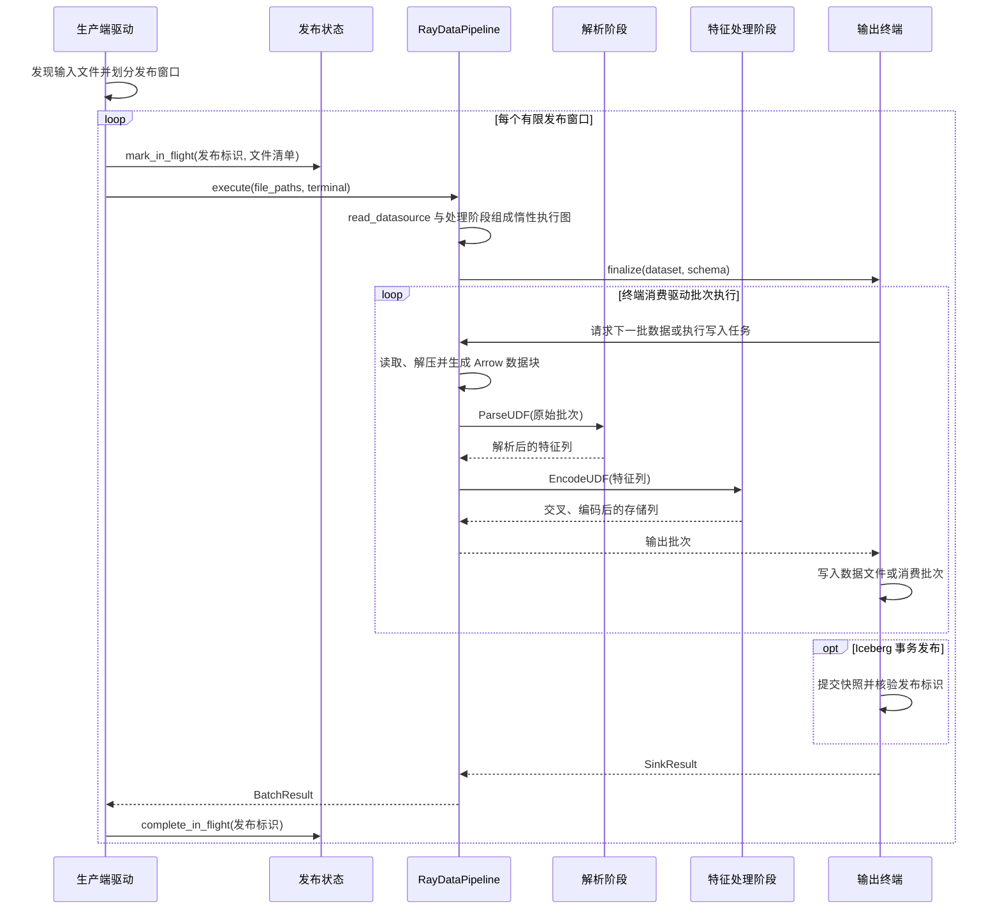

# 数据流水线架构

[English](data_pipeline_architecture.md)

本文档规定 `src/flare/data` 模块的公共架构职责与模块边界。

## 模块职责边界

公共数据层严格分离生产端与消费端。两端共享通用格式适配器与结构化值对象，但在运行时、认证及恢复机制上完全解耦。消费端可服务于模型训练、离线评估及其他数据下游；生产端不依赖模型结构或消费者进度。

```text
src/flare/data/
├── contracts/       阶段输入、输出及数据结构契约
├── schema/          通用结构定义、物理布局与批次变换
├── sources/         区间定义（RecordRange）、物理定位与版本值对象
├── connectors/      外部存储与格式适配器（Iceberg、Parquet 等）
├── execution/       生产执行计划与装配
└── pipeline/
    ├── production/  行解析、处理与数据发布
    └── consumption/ 区间读取、批次组装及向计算设备交付
```

| 事实与行为 | 负责模块 |
| --- | --- |
| 外部快照、数据文件及原生元数据解析 | `connectors/` 格式适配器 |
| 文件区间与物理定位值对象 | `sources/` 值对象 |
| 配置解析与来源对象构造 | `pipeline/consumption/bootstrap/factory.py` |
| 区间向执行任务的转换 | `src/flare/runtime/fluxway/source.py` |
| 任务租约与全局消费进度管理 | 控制面规划组件、求解器与任务账本 |
| 文件读取、解码、缓冲与批次变换 | 格式读取器、`schema` 与 `dataloader` |
| 模型与消费进度的联合检查点 | `checkpoint` 契约组件注册表 |

文件物理行号、扫描位置和执行步属于不同坐标系。Flare 读取器只负责物化被分配的有序区间，不决定全局结束或推进全局消费游标。

## 持久化与流转契约

消费者通过标准表和元数据读取数据，支持有限范围扫描与持续追加扫描。生产者不直接向消费者发送控制消息，不交付任务清单、中间断点或私有终止标记。

- 控制扫描规划入口为 `create_scan_planner`，返回实现标准扫描契约的规划器；
- 有界数据读取通过独立 reader 接口执行；
- 模型与数据源状态仅在全局检查点契约处对齐。

## 数据处理与发布时序

`DataPipeline.run()` 装配处理流水线。特征配置先编译为处理产物和输出结构，
并写出供消费端使用的特征清单。本地输入与分区输入共用确定性文件清单、发布窗口
和租约协议。发现阶段先筛选未处理文件；无匹配文件时报错，输入全部完成则直接返回，
不启动 Ray 或再次追加数据。下面展示每个有限发布窗口的处理过程。



- **处理阶段**：`HdfsZstdDatasource` 负责读取和解压；`ParseUDF` 负责行解析；
  `EncodeUDF` 执行编译好的特征交叉与编码。配置 `fuse_parse_encode` 时，后两者
  合并为一个物理阶段，输出契约不变。
- **执行与背压**：Ray Data 在终端消费时执行惰性图。任务并发、数据块大小、
  生成器缓冲和下游容量约束共同限制在途数据；发布窗口限制一次提交的文件范围。
- **发布与恢复**：Iceberg 终端把发布标识写入快照属性；若提交后、发布状态更新前
  发生故障，恢复流程先按该标识对账，再决定完成记录或重新执行。非事务终端不提供
  同等的提交对账保证，不能据此宣称发布恰好一次。
- **生产与消费分离**：生产端恢复状态记录文件发布进度；训练或评估的检查点记录
  消费进度。消费者通过已提交的存储状态发现数据，两套进度独立。

## 外部来源与 Catalog 会话

`PartitionedSourceProvider` 提供目录列举和文件读取；`IcebergCatalogProvider`
提供表访问。driver 和 worker 各自打开、关闭会话，不共享已打开的连接。
普通 Iceberg 配置使用 `ConfiguredIcebergCatalogProvider`。

发布、快照检查和恢复使用同一套 Catalog 接口。写入要求表 schema 匹配，不自动修改
表结构。平台身份、凭据刷新及血缘由集成方管理，公共 Flare 无需安装平台 SDK。

## 代码入口与后续阅读

| 入口 | 作用 |
| --- | --- |
| [`DataPipeline.run()`](../src/flare/data/pipeline/production/pipeline.py) | 配置解析、恢复对账与执行装配 |
| [`RayDataPipeline.execute()`](../src/flare/data/pipeline/production/publish/orchestrator.py) | 读取、解析、特征处理与终端执行 |
| [`discover_publication_manifest()` / `publish_manifest()`](../src/flare/data/pipeline/production/publish/runner.py) | 来源发现、已处理文件过滤与有限窗口发布 |
| [`execute_publication()`](../src/flare/data/pipeline/production/publication/session.py) | 发布租约及完成状态 |
| [`IcebergSnapshotPublisher`](../src/flare/data/connectors/adapters/iceberg/sink.py) | 事务发布及提交核验 |

消费端见[数据加载流程](dataloader_zh.md)；持续追加、空闲等待和恢复时序见
[流式数据源](streaming_source_zh.md)。
