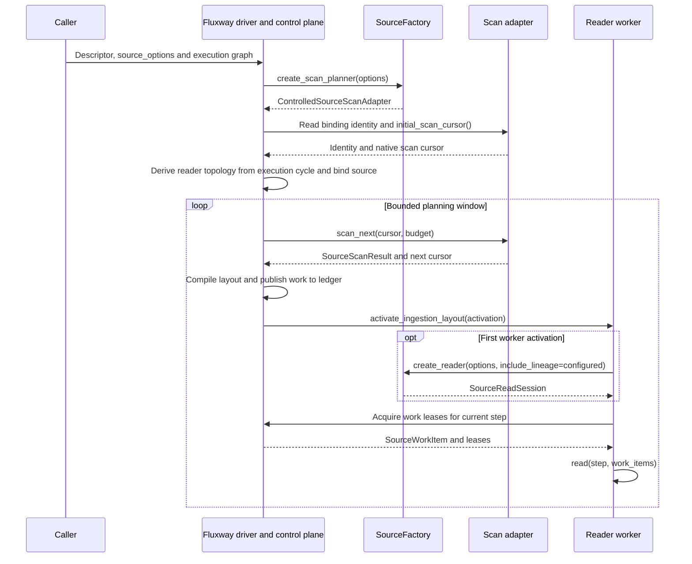
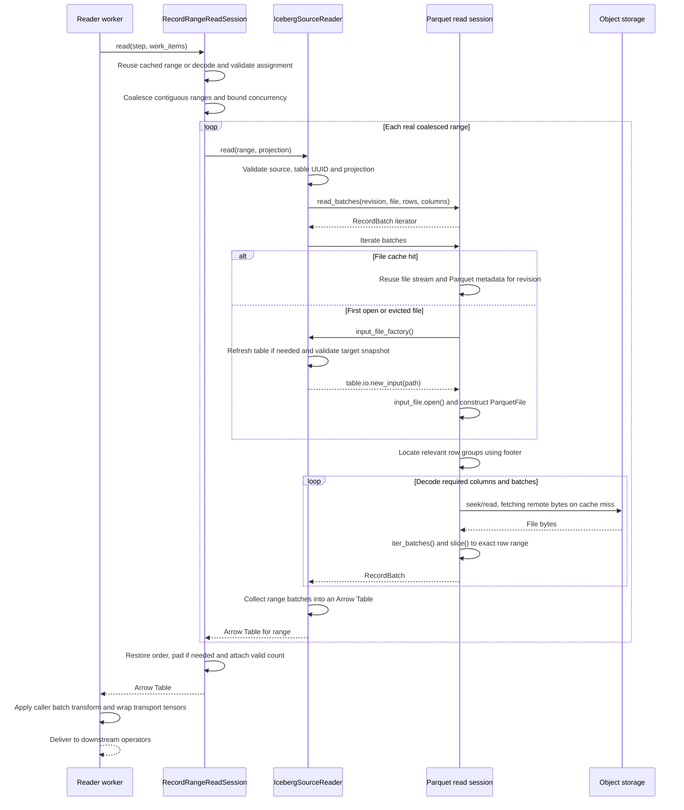

# Dataloader Execution

Loading covers source construction, work assignment, physical reads and batch
transforms. This document focuses on the standard Iceberg source with Fluxway
assigned reads. Training and evaluation can share the same `SourceFactory`.
See [streaming sources](streaming_source.md) for continuous append and recovery.

## Construction and Assignment

Callers supply the table, read mode, physical projection and concurrency options.
Recipes using logical feature names first resolve their feature manifest into a
physical layout; the public data layer receives storage column names.

Scan results describe files and row ranges without carrying training payloads.
The adapter owns format-specific cursor state. Fluxway owns layouts, leases and
global progress. Workers materialize acquired work only.

## Iceberg and Parquet Read Sequence

- **Identity and bounds:** Before materialization, validate step, source,
  projection-contract digest `schema_digest`, revision and physical locator.
  The reader checks table UUID and target
  snapshot. Identity, projection or range mismatches raise errors.
- **Storage access:** Use the table's FileIO through `table.io.new_input()` and
  `InputFile.open()`. REST defaults to `SafeFsspecFileIO`; its S3 backend fetches
  bytes through `GetObject` with `Range` on cache misses. The catalog supplies
  metadata and access configuration; storage serves the file bytes.
- **Read granularity:** Project columns from the row groups covering the range,
  then slice to exact rows. Compression and read-ahead can make physical reads
  larger than the returned payload.
- **Concurrency and caching:** `materialize_source_ranges()` coalesces adjacent
  mergeable ranges, runs up to `source_read_concurrency` reads, and restores input
  order. Blocking reads run in threads. Parquet sessions distinguish source,
  revision and file, lock each file, and cap open handles.
  Assigned range decoding uses a session-local LRU cache of 128 entries keyed by
  the token and all compared identities; changed identities are validated again.
  Range bounds and returned cardinality remain checked on every read.
- **Optional collection:** `LineageConfig` determines `include_lineage` when
  constructing a reader; without it the standard reader creates no input asset
  references. Reader execution auditing requires `execution_audit_path`. Custom
  timing scopes are entered only while `profiler.enabled()` is true. These
  switches do not disable source identity, schema or cardinality contracts.
- **Memory and padding:** The assigned path currently collects batches for one
  coalesced range into an Arrow Table rather than materializing the entire table.
  Synthetic padding has no physical file read. Padding-only batches require an
  explicit schema; downstream consumers preserve valid counts and mask padding.
- **Shutdown:** Workers close assigned sessions, which close format sessions.
  Parquet sessions wait for active reads before closing files. This read path
  does not advance durable consumption cursors or acknowledge a global commit.

## Other Loading Interfaces

These interfaces have separate construction paths; they are not automatically
chained into the assigned reader above.

| Interface | Purpose and boundary |
| --- | --- |
| `ParquetRangeBatchLoader` | Standalone finite loader: discover files, shard file ranges, read batches and apply a caller transform. It provides no Fluxway work ledger or coordinated checkpoint. |
| `StreamingBatchReader` | Assemble successive fragments into batches, separating window boundaries from source termination; see the [fragment sequence](streaming_source.md#fragment-batching-sequence). |
| `AsyncReadSession` / `AsyncBatchExecutor` | Optional bounded read queues, thread pools, task counts and estimated byte budgets; they do not own consumption acknowledgements. |
| `build_reader_source(read_session=...)` | Direct Fluxway `IngestionReadSession` integration, mutually exclusive with descriptor assignment. |
| `DeviceTransferStage` | Reserved device-transfer interface; `transfer()` currently raises `NotImplementedError`. Runtime and downstream operators own actual device delivery. |

The standard Iceberg factory currently registers a Parquet data reader. Native
manifest traversal rejects row filters, delete manifests and non-data files.
Continuous mode follows valid append snapshots only; see the streaming contract.

## Code Entrypoints

| Entrypoint | Responsibility |
| --- | --- |
| [`SourceFactory`](../src/flare/data/pipeline/consumption/source/contracts/source.py) | Separate scan and read contracts |
| [`StandardSourceFactory`](../src/flare/data/pipeline/consumption/bootstrap/factory.py) | Standard construction and option validation |
| [`WorkItemScheduledDatasetSourceDescriptor`](../src/flare/runtime/fluxway/source.py) | Topology binding and session construction |
| [`RecordRangeReadSession`](../src/flare/data/pipeline/consumption/source/execution/record_ranges.py) | Standard range validation and materialization |
| [`materialize_source_ranges()`](../src/flare/data/pipeline/consumption/source/execution/materialization.py) | Range coalescing, bounded concurrency and ordering |
| [`IcebergSourceReader`](../src/flare/data/connectors/adapters/iceberg/source.py) | Table identity and FileIO access |
| [`ParquetInputFileReader`](../src/flare/data/connectors/adapters/parquet/range_reader.py) | File caching, row group reads and shutdown |
| [`BatchReaderSPMD`](../src/flare/runtime/fluxway/workers/reader.py) | Activation, transforms, transport and checkpoint-position validation |

See [data architecture](data_pipeline_architecture.md) and
[the Fluxway source adapter](fluxway_source_adapter.md) for related contracts.
