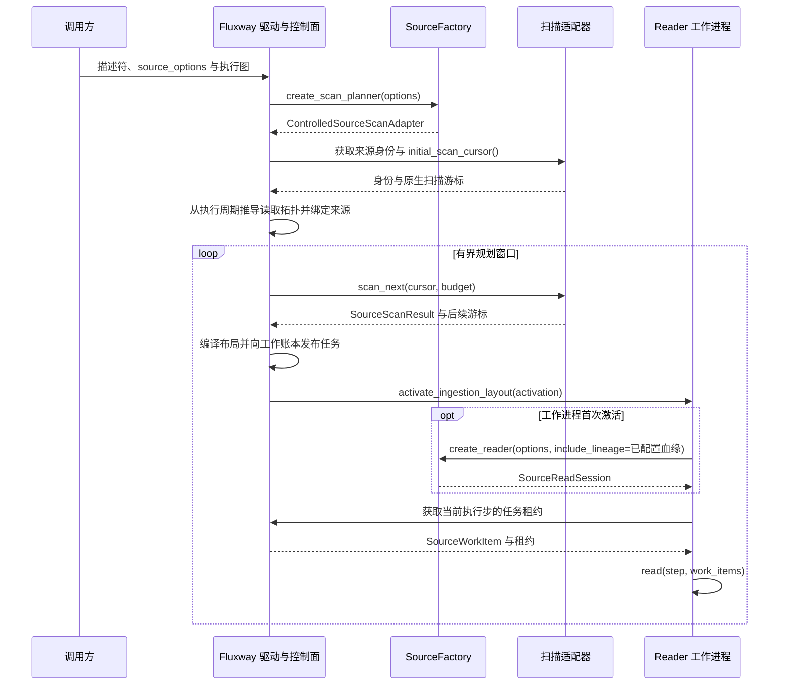
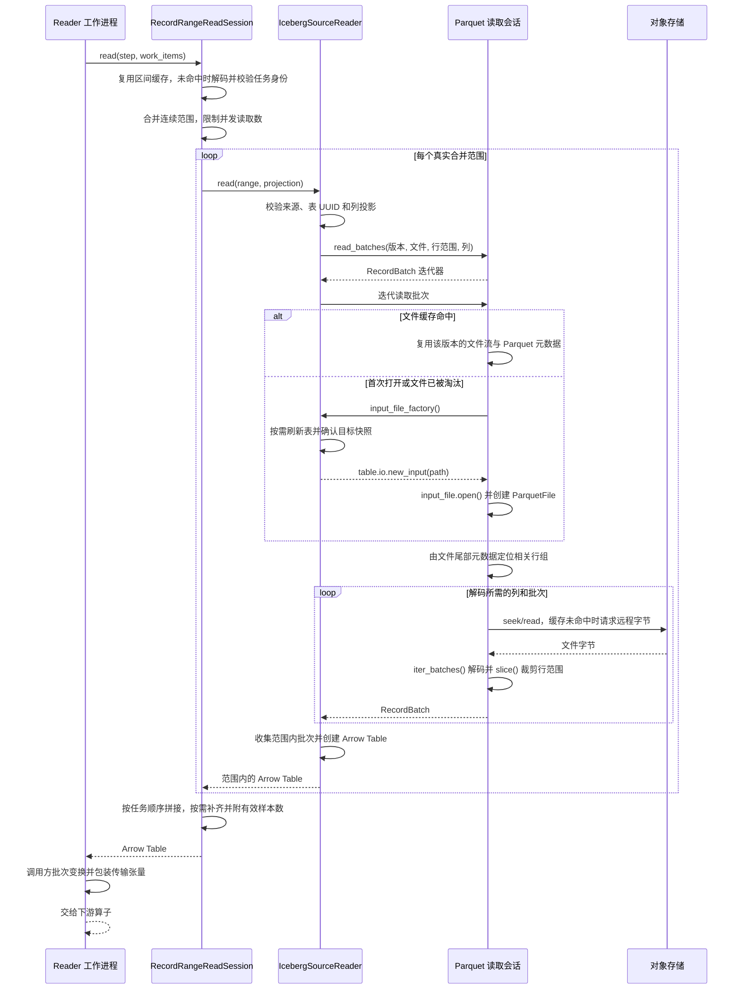

# 数据加载流程

数据加载包括来源装配、任务分配、物理读取和批次变换。本文以标准 Iceberg 数据源
接入 Fluxway 的分配式读取为主；训练和评估可以复用同一 `SourceFactory`。
持续追加与恢复时序见[流式数据源](streaming_source_zh.md)。

## 来源装配与任务分配

调用方提供表、读取模式、物理列投影和并发配置。场景需要逻辑特征名时，先通过
特征清单生成物理列布局；公共数据层接收已确定的存储列名。

扫描结果描述文件和行范围，不携带训练数据。扫描适配器拥有格式相关的游标；
Fluxway 拥有布局、租约与全局进度。工作进程只物化获得的任务。

## Iceberg 与 Parquet 读取时序

- **身份与边界**：物化前校验执行步、来源、投影契约摘要 `schema_digest`、版本和文件定位。
  读取器确认表 UUID 与目标快照；身份、列或范围不匹配会报错。
- **存储访问**：通过 `table.io.new_input()` 和 `InputFile.open()` 使用表的
  FileIO。REST 默认采用 `SafeFsspecFileIO`；S3 后端在缓存未命中时通过带 `Range`
  的 `GetObject` 读取字节。目录服务提供元数据和访问配置，文件字节由存储端返回。
- **读取粒度**：按列投影读取覆盖目标范围的行组（row group），再裁剪为精确行范围。
  压缩和预读缓存可能使物理读取量大于最终返回数据量。
- **并发与缓存**：`materialize_source_ranges()` 合并相邻且可合并的范围，按
  `source_read_concurrency` 并发执行并恢复原顺序；同步读取在线程中运行。
  Parquet 会话按来源、版本及文件区分缓存，同一文件受锁保护，打开文件数有上限。
  分配区间的解码使用会话内最多 128 项的 LRU 缓存，键包含 token 和所有核对的身份；
  身份变化会重新校验。区间边界和返回基数仍在每次读取时检查。
- **可选采集**：创建 reader 时由已有 `LineageConfig` 决定 `include_lineage`，
  未配置时标准 reader 不创建输入资产引用。执行审计需要 `execution_audit_path`；
  仅在 `profiler.enabled()` 为真时进入自定义计时 scope。这些开关不关闭来源身份、
  schema 或基数契约检查。
- **内存与补齐**：当前分配式路径将一个合并范围的批次收集为 Arrow Table，
  不一次物化整张表。补齐任务不读取物理文件；仅补齐批次需要显式 schema，
  有效样本数由下游保留并用于屏蔽补齐行。
- **资源释放**：工作进程关闭分配会话，再关闭格式读取会话。Parquet 会话等待
  活跃读取结束后关闭文件。此路径不会推进持久化消费游标或确认全局提交。

## 其他加载接口

这些接口有各自的装配入口，不是上述路径自动串接的额外阶段。

| 接口 | 用途与边界 |
| --- | --- |
| `ParquetRangeBatchLoader` | 独立有限文件加载器：发现文件、按文件范围分片、逐范围读取、调用批次变换；不提供 Fluxway 全局任务账本或联合检查点。 |
| `StreamingBatchReader` | 将连续片段组装为批次；窗口结束和来源终止分别处理，见[片段组批时序](streaming_source_zh.md#片段组批时序)。 |
| `AsyncReadSession` / `AsyncBatchExecutor` | 可选的有界读取队列、线程池及任务数和估算字节预算；不拥有消费确认。 |
| `build_reader_source(read_session=...)` | 直接接入 Fluxway `IngestionReadSession`，与描述符分配模式互斥。 |
| `DeviceTransferStage` | 预留的设备传输接口；当前 `transfer()` 抛出 `NotImplementedError`。实际设备交付由运行时与下游算子完成。 |

当前标准 Iceberg 工厂注册 Parquet 数据读取器。原生 manifest 遍历不支持行过滤、
删除 manifest 或非数据文件；持续模式仅跟随合法追加快照，具体边界见流式文档。

## 代码入口

| 入口 | 作用 |
| --- | --- |
| [`SourceFactory`](../src/flare/data/pipeline/consumption/source/contracts/source.py) | 扫描与读取的独立契约 |
| [`StandardSourceFactory`](../src/flare/data/pipeline/consumption/bootstrap/factory.py) | 标准来源构造与配置校验 |
| [`WorkItemScheduledDatasetSourceDescriptor`](../src/flare/runtime/fluxway/source.py) | 拓扑绑定与会话创建 |
| [`RecordRangeReadSession`](../src/flare/data/pipeline/consumption/source/execution/record_ranges.py) | 标准区间校验与物化 |
| [`materialize_source_ranges()`](../src/flare/data/pipeline/consumption/source/execution/materialization.py) | 范围合并、有界并发与顺序还原 |
| [`IcebergSourceReader`](../src/flare/data/connectors/adapters/iceberg/source.py) | 表身份与 FileIO 访问 |
| [`ParquetInputFileReader`](../src/flare/data/connectors/adapters/parquet/range_reader.py) | 文件缓存、行组读取与关闭 |
| [`BatchReaderSPMD`](../src/flare/runtime/fluxway/workers/reader.py) | 激活、批次变换、传输与检查点位置校验 |

相关契约见[数据流水线架构](data_pipeline_architecture_zh.md)和
[Flare 与 Fluxway 数据来源适配](fluxway_source_adapter_zh.md)。
