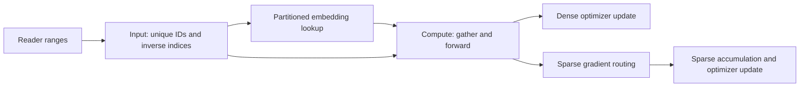

# Sparse embedding pipeline

Flare separates sparse feature processing, partitioned embedding storage and
dense computation into Fluxway operators. Operator dependencies, bounded
in-flight work and transport leases determine when work can overlap. An async
API preserves concurrency at that boundary; it does not establish throughput
or the absence of synchronization throughout the graph.

## Forward and backward paths

Input workers deduplicate each sparse feature group and preserve inverse
indices and row provenance. Independent group preparation uses async fanout.
Embedding workers receive routed unique IDs and call the native store's async
lookup. The sparse `shard` mesh and `PartitionSpec` determine ownership; the
dense `dp` mesh does not define sparse partition identity.

Compute workers receive compact embedding values and inverse indices, then
gather the model's feature layout locally. With CPU sparse storage and CUDA
compute, values cross the host/device boundary. Deduplication reduces repeated
values in that transfer; realized bandwidth depends on the workload, routing
and runtime. The graph also transports labels, side information and validity.

Training routes gradients back to the sparse owners and updates dense state
through the selected execution strategy. Distributed Zero-1 training includes
the collectives required by that strategy. Independent Eval loads replicated
model weights in each compute worker and performs local forward computation.
See [mesh and inference weights](mesh_and_inference.md) for those contracts.

## Feature and storage schemas

The application owns feature names, feature-group interpretation and model
input order. The native store owns supported value dimensions and partition
schemas. Flare validates the supplied mappings when composing these owners;
it does not infer an application's feature schema. Reordering model features
to satisfy a storage layout changes model semantics.

## State, checkpoints and inference

sparse_embedding owns native table state, optimizer state, checkpoint
fragments, lineage and partition restore. Fluxway coordinates graph lifecycle
and durable source/model cuts. Flare composes typed partition mappings and
passes opaque owner restore payloads through that boundary.

At a checkpoint cut inside an accumulation window, registered finalizers
apply the pending dense and sparse update using the actual window length
before storage staging. Finalization does not consume another source batch.
A changed sparse topology requires a new owner FULL root before subsequent
incremental saves; publication and acknowledgement follow the owner lifecycle.
Graceful restore alone does not prove correctness across a process crash.

Independent inference receives the model definition, immutable published
`steps/<step>` weight asset and its own topology. The asset exposes `model/`
and `sparse/`; model-only and sparse inference adapters load the required
weights without training refs, optimizer state, source cursors or controller
metadata. Missing assets and incompatible schemas raise errors.

Source scheduling, padding validity and coordinated Reader positions are
specified in the [source adapter](fluxway_source_adapter.md). Application
schema, compiled forwards, metrics and runnable commands are maintained in
the [recipe guides](../recipes/README.md).
