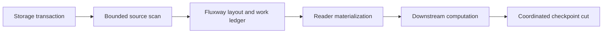

# Streaming Source

Flare separates source-format discovery from scheduled materialization.
Fluxway owns work assignment, execution progress and coordinated checkpoint
cuts. The same boundaries apply to finite datasets and continuous append
sources.

## Architecture and Data Path

Producers publish ordinary storage transactions, such as Ray Data Iceberg
appends. They do not publish training cursors, consumer work assignments or
completion markers. Consumers select their own source identity, snapshot mode
and completion policy.

`SourceFactory.create_scan_planner()` supplies a `ControlledSourceScanAdapter`.
Its `scan_next(cursor, budget)` returns typed `SourceScanResult` metadata:
ordered layout units, unit cursors, source/schema identity, the next opaque
cursor and source status. `advance_cursor()` advances native cursor state
without reading table rows. The Iceberg adapter plans file intervals from
snapshot manifests and their record counts.

`SourceFactory.create_reader()` supplies a `SourceReader` for physical reads.
`AssignedSourceBatchReader` decodes real assigned ranges into
`SourceRecordRange`, validates their identity and bounds, and materializes
them with bounded read concurrency. Workers do not independently discover
files, poll catalogs or advance the durable source cursor.

## Scheduling and Progress

`WorkItemScheduledDatasetSourceDescriptor` derives Reader demand from the
compiled Fluxway execution cycle. Fluxway's layout compiler and logical work
ledger own assignments, leases and acknowledgements. Placement and routing
must use the actual worker topology; a recipe must not duplicate their worker
index calculations or infer node locality from worker counts.

A source window bounds admission and prefetch. Its end is not a discard
boundary. Unconsumed logical work remains with its owner for the next
contiguous activation. Source adapters report finite exhaustion or a
continuous source waiting for more data through typed scan status.

## Batch Alignment and Terminal Policies

The source descriptor maps the selected policy to Fluxway's tail layout mode:

| Policy | Layout mode | Incomplete remainder |
| --- | --- | --- |
| `carry` | `RETAIN_PENDING` | Retained for later work; not emitted as a partial batch. |
| `drop` | `DISCARD_REMAINDER` | Discarded. |
| `pad` | `SYNTHESIZE_PADDING` | Combined with typed synthetic padding work. |
| `require` | `REJECT_REMAINDER` | Rejected with an error. |

Synthetic padding is not a physical source range. A padding-only Reader uses
an explicit Arrow schema and performs no data read. Assigned batches carry
global valid-prefix metadata, including full batches. Consumers preserve that
metadata through their payloads. Downstream losses, sparse materialization
and metrics use the valid count to mask padding.

A finite run that retains or drops a remainder can end with rows that never
reached the model. Reconcile source rows, emitted valid samples and the
selected tail policy separately from the number of completed steps.

## Checkpoint and State Recovery

Fluxway coordinates source scan state, committed work progress and downstream
operator state at a common durable cut. Native cursor payloads remain owned
by the source adapter. Reader checkpoint state contains the coordinated
position and validates it against the checkpoint context; it does not contain
a second source cursor or the previous worker's file iterator.

Restore re-establishes the committed logical position and plans uncommitted
work for the current topology. Arrow tables, NumPy buffers, object references
and prefetch buffers are transient. Physical reads can repeat after a failure;
exactly-once acceptance concerns committed model/data progress and requires
crash/restart reconciliation at durable cuts. An issued-work audit or graceful
topology change alone cannot establish that property.

See [the source adapter contract](fluxway_source_adapter.md) for construction
and checkpoint-registration details.
