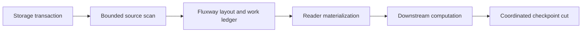
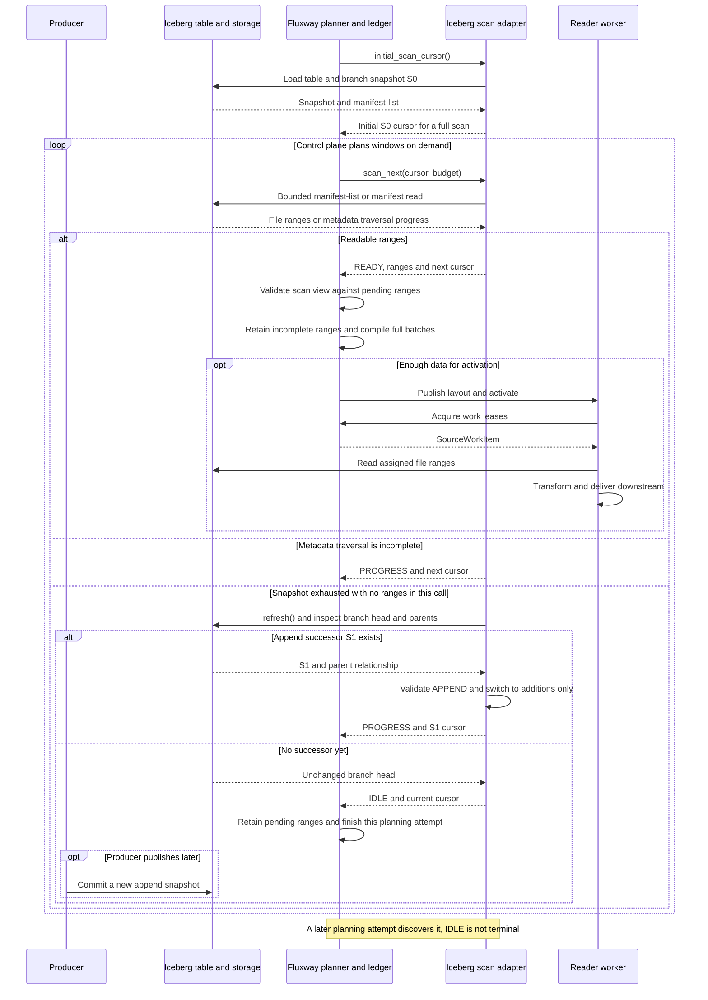
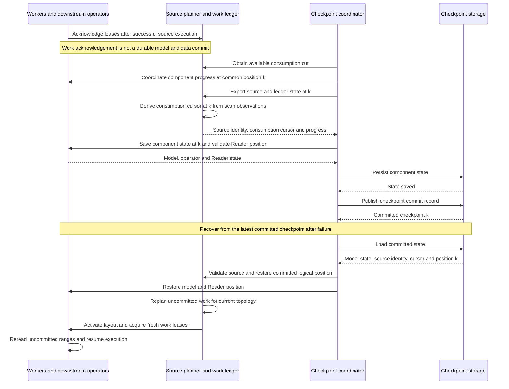
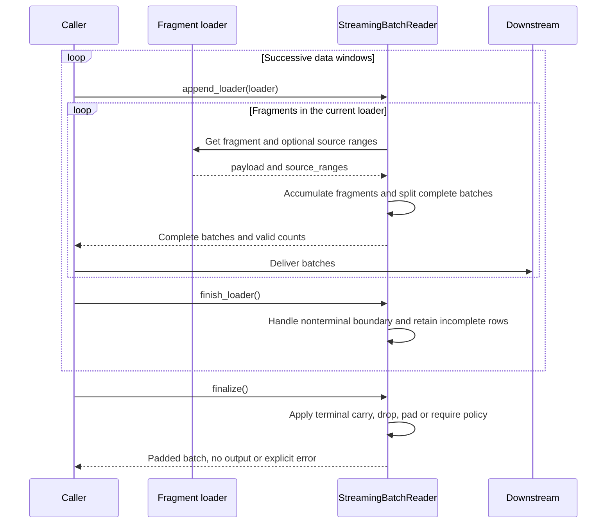

# Streaming Source

Flare separates source-format discovery from scheduled materialization.
Fluxway owns work assignment, execution progress and coordinated checkpoint
cuts. The same boundaries apply to finite datasets and continuous append
sources.

## Streaming Interfaces

| Interface | Meaning |
| --- | --- |
| Iceberg `ContinuousAppend` | Discover committed append snapshots continuously and schedule them through Fluxway. |
| `StreamingBatchReader` | Assemble successive fragments into batches; it owns neither source discovery nor global work acknowledgement. |
| `RayDataStreamDrainer` | Consume and release batches from one Ray Data execution. It is a nontransactional production terminal, not a transport channel to training workers. |

See [data architecture](data_pipeline_architecture.md) for the production
parse, encode and publication sequence.

## Architecture and Data Path

Producers publish ordinary storage transactions, such as Ray Data Iceberg
appends. They do not publish training cursors, consumer work assignments or
completion markers. Consumers select their own source identity, snapshot mode
and completion policy.

`SourceFactory.create_scan_planner()` supplies a `ControlledSourceScanAdapter`.
Its `scan_next(cursor, budget)` returns typed `SourceScanResult` metadata:
ordered layout units, unit cursors, source/schema identity, the next opaque
cursor and source status. `advance_cursor()` advances native cursor state
without reading table rows. The Iceberg adapter plans file intervals from
snapshot manifests and their record counts.

`SourceFactory.create_reader()` supplies a `SourceReadSession` that returns a
native payload, its cardinality and confirmed input assets in `SourceBatch`.
For standard file sources, `RecordRangeReadSession` decodes real assigned ranges into
`SourceRecordRange`, validates their identity and bounds, and materializes
them with bounded read concurrency. Workers do not independently discover
files, poll catalogs or advance the durable source cursor.
Native query/shard sessions interpret their own opaque tasks and bypass file
decoding. Direct segment reads keep Fluxway's `IngestionReadSession` contract;
an arbitrary iterator does not imply replay, partitioning or recovery support.

## Continuous Append Sequence

Select `mode=ContinuousAppend(branch="main")` for continuous reads. The initial
scan reads all live data in the branch's current snapshot. Subsequent scans
follow the parent chain in order and read additions from each append snapshot.
The default mode is finite; `iceberg_snapshot_id` selects a pinned snapshot.
An empty branch returns no initial cursor, allowing a later planning attempt.

| Scan status | Control-plane meaning |
| --- | --- |
| `READY` | Assignable ranges are available; batch and topology requirements still apply. |
| `PROGRESS` | Cursor advanced without output ranges, such as traversing metadata or switching snapshots; continue scanning. |
| `IDLE` | The continuous source has no new data yet; retain progress for a later planning attempt. |
| `TERMINAL` | A finite source is exhausted; process any ranges in the result, then apply the terminal tail policy. |

Each native traversal processes at most one metadata block and respects record,
unit and block-byte budgets. Ranges retain table, snapshot, file and row-offset
identity; see [dataloader execution](dataloader.md) for physical reads. Changed
table UUIDs, missing snapshots or parents, and non-append successors raise
errors. Native traversal currently rejects row filters, delete manifests and
non-data files instead of skipping those constraints.

**Snapshot boundaries:** The current control plane accepts a scan-view change
only when no incomplete work units are pending. An incomplete tail at the end of
a snapshot is retained and causes identity validation to reject the successor
view. Do not assume arbitrary tails can be batched across snapshots.

## Scheduling and Progress

`WorkItemScheduledDatasetSourceDescriptor` derives Reader demand from the
compiled Fluxway execution cycle. Fluxway's layout compiler and logical work
ledger own assignments, leases and acknowledgements. Placement and routing
must use the actual worker topology; a recipe must not duplicate their worker
index calculations or infer node locality from worker counts.

A source window bounds admission and prefetch. Its end is not a discard
boundary. Unconsumed logical work remains with its owner for the next
contiguous activation. Source adapters report finite exhaustion or a
continuous source waiting for more data through typed scan status.

## Batch Alignment and Terminal Policies

The source descriptor maps the selected policy to Fluxway's tail layout mode:

| Policy | Layout mode | Incomplete remainder |
| --- | --- | --- |
| `carry` | `RETAIN_PENDING` | Retain across nonterminal boundaries without emitting partial batches; remaining rows do not reach the model at finite termination. |
| `drop` | `DISCARD_REMAINDER` | Discarded. |
| `pad` | `SYNTHESIZE_PADDING` | Combined with typed synthetic padding work. |
| `require` | `REJECT_REMAINDER` | Rejected with an error. |

Synthetic padding is not a physical source range. A padding-only Reader uses
an explicit Arrow schema and performs no data read. Assigned batches carry
global valid-prefix metadata, including full batches. Consumers preserve that
metadata through their payloads. Downstream losses, sparse materialization
and metrics use the valid count to mask padding.

A finite run that retains or drops a remainder can end with rows that never
reached the model. Reconcile source rows, emitted valid samples and the
selected tail policy separately from the number of completed steps.

## Checkpoint and State Recovery

Fluxway coordinates source scan state, committed work progress and downstream
operator state at a common durable cut. Native cursor payloads remain owned
by the source adapter. Reader checkpoint state contains the coordinated
position and validates it against the checkpoint context; it does not contain
a second source cursor or the previous worker's file iterator.

Restore re-establishes the committed logical position and plans uncommitted
work for the current topology. Arrow tables, NumPy buffers, object references
and prefetch buffers are transient. Physical reads can repeat after a failure;
exactly-once acceptance concerns committed model/data progress and requires
crash/restart reconciliation at durable cuts. An issued-work audit or graceful
topology change alone cannot establish that property.

Component saves are summarized by contract and can execute concurrently. Scan
prefetch may be ahead of position `k`; `_cursor_at_cut()` derives the consumption
cursor for the coordinated cut instead of persisting the latest scan position.
`source_identity`, `schema_digest` and `lineage_digest` validate consistency.
The latter belongs to source recovery, not an external lineage reporting API.

## Fragment Batching Sequence

`StreamingBatchReader` is a standalone batch assembly tool. Fluxway assigned
reads align batches in the layout layer and do not automatically use this
assembler. Callers distinguish a temporary loader boundary from source termination.

`finish_loader()` does not treat a temporary lack of data as termination.
At `finalize()`, `carry` and `drop` emit no remaining fragments, `pad` returns
a padded batch with valid counts, and `require` rejects incomplete batches.
Checkpointing an incomplete batch requires source ranges; only ranges and
counts are stored. After restore, callers reread and append `replay_ranges`
instead of restoring previous Arrow or NumPy buffers.

## Code Entrypoints

| Entrypoint | Responsibility |
| --- | --- |
| [`ContinuousAppend` / `PinnedSnapshot`](../src/flare/data/connectors/adapters/iceberg/modes.py) | Explicit scan modes |
| [`IcebergSourcePlanner`](../src/flare/data/connectors/adapters/iceberg/source.py) | Initialization, refresh, parent traversal and append validation |
| [`IcebergManifestTraversal`](../src/flare/data/connectors/adapters/iceberg/manifest_stream.py) | Bounded native metadata traversal |
| [`IcebergSourceScanAdapter`](../src/flare/data/connectors/adapters/iceberg/scan.py) | Layout units, scan states and opaque cursors |
| [`source_checkpoint_registration()`](../src/flare/runtime/fluxway/workers/reader.py) | Reader checkpoint registration and position checks |
| [`StreamingBatchReader`](../src/flare/data/pipeline/consumption/source/batching/stream_reader.py) | Fragment assembly, termination and replay ranges |

Fluxway's `IngestionLayoutPlanningComponent`, `AlgebraicLayoutCompiler` and
`LogicalWorkLedger` own planning, layout compilation, leases and durable cuts.

See [the source adapter contract](fluxway_source_adapter.md) for construction
and checkpoint-registration details.
