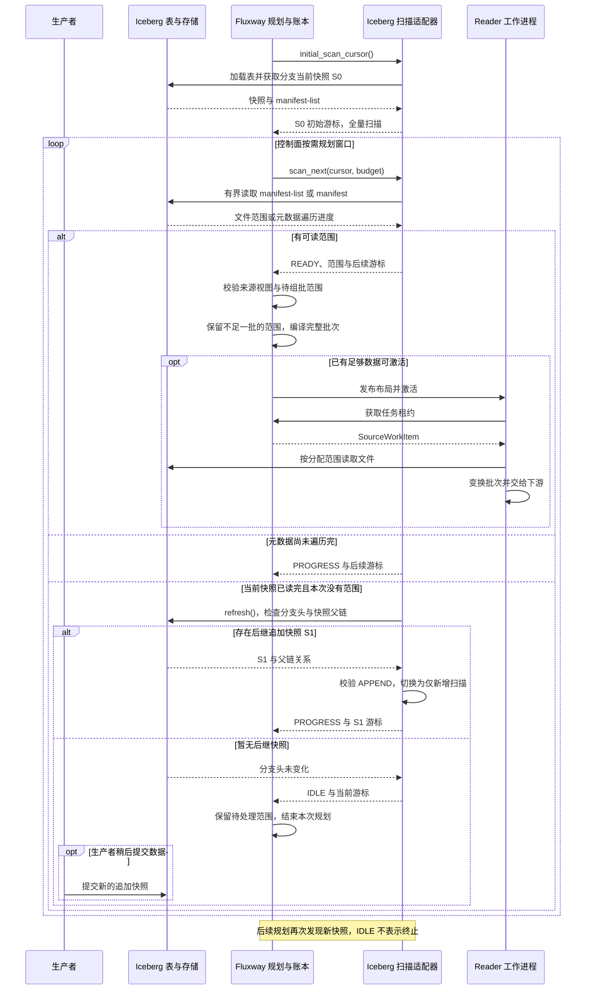
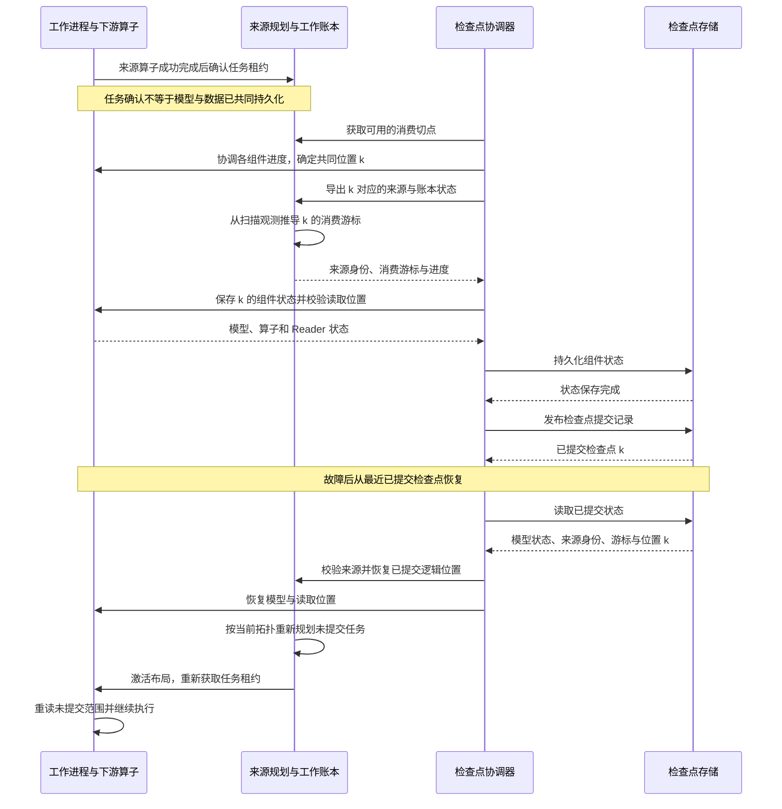
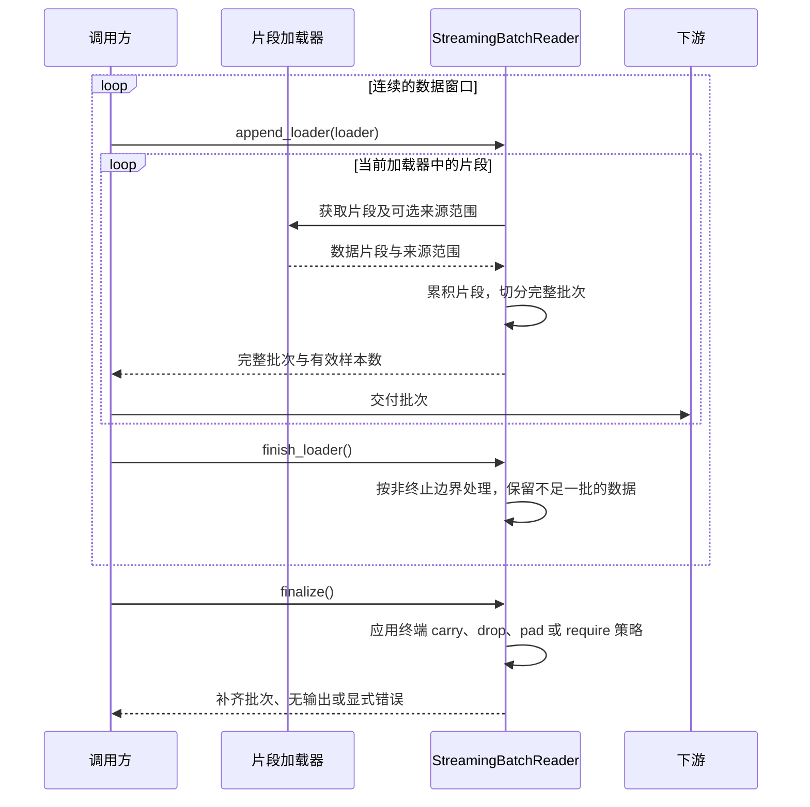

# 流式数据源

Flare 将来源格式发现与按调度读取分开；Fluxway 负责工作分配、执行进度和联合检查点
切点。有限数据集与持续追加来源使用相同的职责边界。

## 流式接口的区别

| 接口 | 含义 |
| --- | --- |
| Iceberg `ContinuousAppend` | 持续发现已提交的追加快照，并交由 Fluxway 调度消费。 |
| `StreamingBatchReader` | 将连续到达的片段组装为批次，不负责来源发现或全局任务确认。 |
| `RayDataStreamDrainer` | 逐批消费并释放一次 Ray Data 执行的结果；属于非事务生产终端，不是连接训练进程的数据通道。 |

生产端的解析、编码和发布时序见[数据流水线架构](data_pipeline_architecture_zh.md)。

## 架构与数据路径

生产者正常提交存储事务，例如通过 Ray Data 追加 Iceberg 数据。生产者不发布训练游标、
消费任务分配或结束标记。消费者自行选择来源身份、快照模式和尾部策略。

`SourceFactory.create_scan_planner()` 提供 `ControlledSourceScanAdapter`。
`scan_next(cursor, budget)` 返回类型化的 `SourceScanResult` 元数据，包括有序布局
单元、单元游标、来源与结构契约身份、下一个不透明游标和来源状态。
`advance_cursor()` 在不读取表中数据行的情况下推进原生游标。Iceberg 适配器根据
快照 manifest 中的文件和行数规划区间。

`SourceFactory.create_reader()` 提供 `SourceReadSession`，通过 `SourceBatch` 返回
原生 payload、实际基数及已确认的输入资产。标准文件来源的 `RecordRangeReadSession`
将真实分配区间解码为 `SourceRecordRange`，核对身份
及边界，并以有界并发读取。工作进程不独立发现文件、轮询目录或推进持久化来源游标。
原生查询/分片会话自行解释不透明任务，无需文件解码；直接分段读取继续复用 Fluxway
的 `IngestionReadSession`。任意 iterator 本身不等于具备重放、分片或恢复能力。

## 持续追加来源时序

扫描模式由 `mode=ContinuousAppend(branch="main")` 指定。首次扫描读取所选分支
当前快照的全部有效数据，后续沿父链依次消费追加快照中的新增数据。默认模式是
有限扫描；`iceberg_snapshot_id` 指定固定快照。分支尚无快照时，初始游标为
`None`，控制面稍后重试规划。

| 扫描状态 | 控制面含义 |
| --- | --- |
| `READY` | 得到可分配范围；仍需累积到满足批次与拓扑需求。 |
| `PROGRESS` | 游标已前进但没有输出范围，例如遍历元数据或切换快照；继续扫描。 |
| `IDLE` | 持续来源暂时没有新数据；保留进度并等待下一次规划。 |
| `TERMINAL` | 有限来源耗尽；处理本次携带的范围，再应用终端尾部策略。 |

每次原生遍历最多处理一个元数据块，并受记录数、输出单元数和块字节数预算约束。
范围保留表身份、快照、文件及行偏移；实际读取见[数据加载时序](dataloader_zh.md)。
表 UUID 改变、快照或父链缺失、非追加后继快照会报错。当前原生遍历不支持行过滤、
删除 manifest 或非数据文件，不会跳过这些约束继续消费。

**快照边界**：当前控制面仅在待组批范围为空时接受扫描视图切换。如果快照末尾
不足一个批次，保留的范围会使后继视图触发身份校验错误；不能假定任意快照尾部
都能自动跨快照拼批。

## 调度与进度

`WorkItemScheduledDatasetSourceDescriptor` 从 Fluxway 编译的执行周期推导 Reader
需求。Fluxway 的布局编译器与逻辑工作账本负责分配、租约和任务确认。
放置与路由使用实际工作进程拓扑；场景代码不重复计算进程索引，也不能仅凭
进程数量推断节点局部性。

调度窗口限制任务准入与预取规模，其结束不是数据丢弃边界。尚未消费的逻辑
工作由负责组件保留到下一次连续激活。来源适配器用类型化扫描状态报告
有限来源耗尽，或持续来源正在等待更多数据。

## 批次补齐与终端状态

来源描述将选定策略映射为 Fluxway 尾部布局模式：

| 策略 | 布局模式 | 不完整的剩余数据 |
| --- | --- | --- |
| `carry` | `RETAIN_PENDING` | 跨非终止边界保留，不发出不完整批次；有限来源终止时剩余行不进入模型。 |
| `drop` | `DISCARD_REMAINDER` | 丢弃。 |
| `pad` | `SYNTHESIZE_PADDING` | 与类型化补齐任务合并，发出固定形状批次。 |
| `require` | `REJECT_REMAINDER` | 直接报错。 |

补齐任务不是物理来源区间。仅包含补齐行的读取使用显式 Arrow
schema，不读取数据。分配批次携带全局有效前缀计数；排名任务的传输将其表示为一个
int32 `samples_valid_count` 标量，完整批次也包含该标量。下游损失、稀疏物化和指标
根据该计数屏蔽补齐行。

有限运行保留或丢弃尾部后，可能仍有数据从未进入模型。来源行数、实际发出的有效
样本数和尾部策略必须单独对账，不能由完成步数推断。

## 检查点与恢复

Fluxway 在共同持久化切点协调来源扫描状态、已提交工作进度和下游算子状态。
原生游标内容仍由来源适配器拥有。Reader 检查点保存并校验共同位置 `position`，
不保存第二份来源游标或旧进程的文件迭代器。

恢复时先建立已提交逻辑位置，再按当前拓扑重新规划未提交工作。Arrow 表、NumPy
缓冲区、对象引用和预取数据都是临时状态。故障后物理读取可能重复；恰好一次的
验收针对模型与数据的已提交进度，需要在持久化切点上执行崩溃与恢复对账。
仅有任务下发审计或正常退出后的拓扑变更不能证明这一性质。

图中组件保存按契约汇总表示，实际可并发执行。扫描预取位置可能领先于位置 `k`；
检查点通过 `_cursor_at_cut()` 计算共同切点的消费游标，不直接保存最新扫描位置。
`source_identity`、`schema_digest` 和 `lineage_digest` 用于一致性校验；其中
`lineage_digest` 是来源恢复契约的一部分，不是外部血缘上报接口。

## 片段组批时序

`StreamingBatchReader` 是独立的批次组装工具。Fluxway 分配式读取在布局层对齐批次，
不会自动再套用这个组装器。调用方需要区分临时加载器结束与整个来源终止。

`finish_loader()` 不把暂时无数据当成来源终止。`finalize()` 下，`carry` 和 `drop`
不发出剩余片段，`pad` 返回带有效计数的补齐批次，`require` 拒绝不完整批次。
若要保存未满批次，必须同时提供来源范围；检查点只记录范围和计数。恢复后调用方
根据 `replay_ranges` 重读并重新追加这些片段，不恢复旧的 Arrow 或 NumPy 缓冲区。

## 代码入口

| 入口 | 作用 |
| --- | --- |
| [`ContinuousAppend` / `PinnedSnapshot`](../src/flare/data/connectors/adapters/iceberg/modes.py) | 显式扫描模式 |
| [`IcebergSourcePlanner`](../src/flare/data/connectors/adapters/iceberg/source.py) | 初始化、刷新、快照父链与追加校验 |
| [`IcebergManifestTraversal`](../src/flare/data/connectors/adapters/iceberg/manifest_stream.py) | 有界原生元数据遍历 |
| [`IcebergSourceScanAdapter`](../src/flare/data/connectors/adapters/iceberg/scan.py) | 布局单元、扫描状态与不透明游标 |
| [`source_checkpoint_registration()`](../src/flare/runtime/fluxway/workers/reader.py) | Reader 检查点注册与位置校验 |
| [`StreamingBatchReader`](../src/flare/data/pipeline/consumption/source/batching/stream_reader.py) | 片段组批、终止与恢复范围 |

控制面的规划、布局编译、租约及持久化切点由 Fluxway 的
`IngestionLayoutPlanningComponent`、`AlgebraicLayoutCompiler` 和 `LogicalWorkLedger`
负责。

来源构造与检查点注册方式见[来源适配契约](fluxway_source_adapter_zh.md)。
